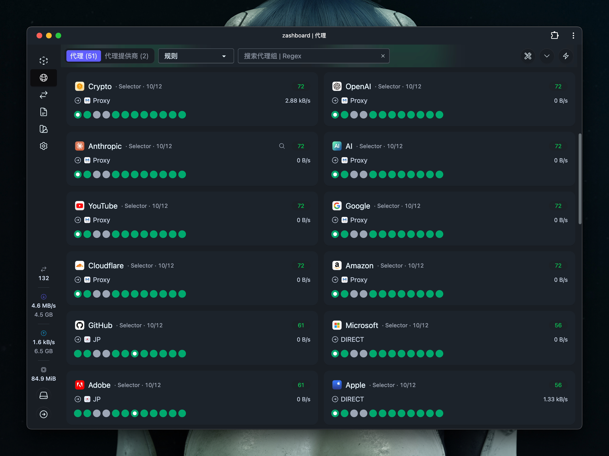

<p align="center">
  
</p>

<h1 align="center">Yggdrasil · 世界树</h1>

<p align="center">
  <strong>以规则为枝，以节点为叶。</strong><br />
  为 Mihomo 整理的分流配置、节点策略与订阅中枢。
</p>

<p align="center">
  <a href="https://wiki.metacubex.one/"></a>
  <a href="#配置模板"></a>
  <a href="LICENSE"></a>
</p>

<p align="center">
  <a href="#配置模板">配置模板</a> ·
  <a href="#快速开始">快速开始</a> ·
  <a href="#节点策略">节点策略</a> ·
  <a href="#订阅中枢">订阅中枢</a> ·
  <a href="#许可与授权">许可与授权</a>
</p>

---

> [!IMPORTANT]
> **使用前须取得相应原作者或权利人的书面许可。**
> 本项目原创内容采用专有授权声明，个人及非商业使用同样需要授权。完整条款见 [LICENSE](LICENSE)；授权申请可通过 [Issues](https://github.com/yakasuka/yggdrasil/issues) 联系维护者。第三方素材遵循各自的权利声明与许可。

## 配置模板

从完整的网络接管，到轻量的应用分流，按需要选择一份配置。

| 模板 | 地区 | 主要内容 |
| :--- | :--- | :--- |
| **[Yggdrasil](yggdrasil.yaml)** | 6 + 其他 | 完整配置：DNS、TUN、嗅探与详细规则集 |
| **[Ratatoskr](Ratatoskr.yaml)** | 6 + 其他 | 日常应用分流，使用本仓库 `icons/` 图标 |
| **[Ratatosk · Eb](Ratatosk-Eb.yaml)** | 24 + 其他 | 地区扩展，使用 macOSicons 图标 |

三份模板独立维护，策略组与规则并非完全相同；仓库文件名以链接为准。

<details>
<summary><strong>查看配置直链</strong></summary>

取得授权后，可下载文件或将对应地址导入客户端：

| 模板 | 配置地址 |
| :--- | :--- |
| Yggdrasil | [yggdrasil.yaml](https://raw.githubusercontent.com/yakasuka/yggdrasil/main/yggdrasil.yaml) |
| Ratatoskr | [Ratatoskr.yaml](https://raw.githubusercontent.com/yakasuka/yggdrasil/main/Ratatoskr.yaml) |
| Ratatosk · Eb | [Ratatosk-Eb.yaml](https://raw.githubusercontent.com/yakasuka/yggdrasil/main/Ratatosk-Eb.yaml) |

</details>

## 快速开始

1. **确认授权与内核。** 取得使用许可，选择支持当前配置语法的 Mihomo 客户端，并准备相应的 GeoSite / GeoIP 数据。
2. **填入自己的订阅。** 在本地将 `proxy-providers` 调整为自己的机场订阅；手动节点填入 `proxies`。订阅名称、节点名称应保持唯一。
3. **导入并加载。** 导入所选 YAML，在“节点选择”或具体应用组中选择出口。完整模板会同时配置 DNS 与 TUN，按设备环境检查相关设置。
4. **重新测速。** 三份模板均启用 `unified-delay: true`；加载配置后重新测试延迟，客户端覆写项也应保持一致。

| 模板 | HTTP | SOCKS5 |
| :--- | :--- | :--- |
| Yggdrasil | `7890` | `7890` |
| Ratatoskr / Eb | `7890` | `7891` |

Yggdrasil 使用混合端口，HTTP 与 SOCKS5 共用 `7890`。

个人订阅地址、节点凭据与访问令牌应在本地或私有订阅流程中维护。公开配置地址提供项目配置文件，不包含使用授权。

## 节点策略

| 策略 | 行为 | 适用方式 |
| :--- | :--- | :--- |
| 🚀 手动切换 | 手动指定一个节点 | 固定出口 |
| ♻️ 自动选择 | 根据测试延迟选取节点 | 自动选择低延迟节点 |
| 🔯 故障转移 | 按顺序使用首个可用节点 | 优先节点不可用时顺延 |
| 🔮 负载均衡 | `consistent-hashing`，按目标地址分配 | 同一目标尽量保持相同出口 |
| ⚖️ 下载均衡 | `round-robin`，轮询分配新连接 | 分散多个独立连接 |

上表描述策略本身；应用是否使用某个策略，取决于其可选项、当前选择和规则命中。轮询不会将单条连接拆分，也不保证多节点带宽叠加。

统一延迟会优先取复用连接的第二次请求耗时，减少握手等额外开销对读数的影响。相关参数见 [Mihomo 全局配置](https://wiki.metacubex.one/config/general/#统一延迟)。

### 地区分类

**常用地区**：香港、台湾、日本、韩国、新加坡、美国，另设“其他”入口。

<details>
<summary><strong>展开 Eb 版的 24 个国家 / 地区</strong></summary>

| 区域 | 国家 / 地区 |
| :--- | :--- |
| 东亚 | 香港、台湾、澳门、日本、韩国 |
| 东南亚 | 新加坡、泰国、马来西亚、越南、菲律宾、印度尼西亚 |
| 南亚与大洋洲 | 印度、澳大利亚 |
| 北美与南美 | 美国、加拿大、巴西、阿根廷 |
| 欧洲及其他 | 英国、德国、法国、荷兰、瑞士、俄罗斯、土耳其 |

</details>

地区分类按节点名称中的国旗、中英文名称、地区代码及部分城市别名匹配，实际落地以机场说明为准。名称同时包含多个地区标记时，可能进入多个分组；各模板的具体匹配范围见对应 `filter`。

## 图标与界面

`icons/` 保存日常模板使用的图标；`icons/macosicons/` 保存 Eb 版使用的 42 张 macOSicons PNG、预览与作者信息。

<p align="center">
  
  
  
  
  
  
</p>

<p align="center">
  <a href="icons/macosicons/preview.png">完整图标预览</a> ·
  <a href="icons/macosicons/README.md">作者与来源</a> ·
  <a href="icons/macosicons/manifest.json">映射清单</a>
</p>

Eb 版地区组统一使用 Maps；Bybit 暂用 Wallet，TapTap 暂用 Game Center。图标作品与品牌标识的权利归各自作者或品牌方所有。

<details>
<summary><strong>查看 Zashboard 面板效果参考</strong></summary>



项目已有的面板展示素材，分组名称、节点状态与数值以实际运行结果为准。

</details>

## 订阅中枢

仓库包含供 Cloudflare Pages Functions 使用的两个接口，配合公开模板与私有订阅文件工作：

| 路径 | 对应文件 | 职责 |
| :--- | :--- | :--- |
| `/merge?token=…` | [functions/merge.js](functions/merge.js) | 读取公开模板，将私有 `providers.yaml` 写入自动订阅标记区 |
| `/sub?token=…` | [functions/sub.js](functions/sub.js) | 读取私有 `nodes.yaml`，返回节点 YAML |

部署环境变量：

| 变量 | 用途 |
| :--- | :--- |
| `TOKEN` | 两个接口的访问令牌 |
| `GH_TOKEN` | 读取私有仓库文件的 GitHub 凭据 |
| `PUBLIC_CONFIG_URL` | `/merge` 使用的公开配置地址 |

当前接口指向 `yakasuka/yggdrasil-private`。迁移部署时，应同步调整私有仓库位置与环境变量。模板中的 `AUTO-PROVIDERS-START` / `AUTO-PROVIDERS-END` 标记需成对保留。

`/sub` 返回的 `Subscription-Userinfo` 为模拟流量信息，不代表机场实际用量。

## 项目结构

```text
.
├── LICENSE                 使用前须书面授权的专有声明
├── yggdrasil.yaml           DNS / TUN / 嗅探完整模板
├── Ratatoskr.yaml           日常应用分流模板
├── Ratatosk-Eb.yaml         24 地区扩展模板
├── assets/                 世界树品牌标识与生成说明
├── Rules/                  自定义补充规则
├── functions/              订阅与配置合并接口
├── icons/                  图标、面板素材与作品来源
└── index.html              世界树主题展示页
```

## 许可与授权

**All Rights Reserved · Prior Written Permission Required**

本项目原创内容保留所有权利。使用、运行、修改、再分发、公开部署或商业使用，须事先取得相应原作者或权利人的书面许可；个人与非商业用途同样适用。完整范围、例外与免责条款见 [LICENSE](LICENSE)。

申请授权时，请通过 [Issues](https://github.com/yakasuka/yggdrasil/issues) 说明使用者、用途、涉及文件及是否修改或再分发，由维护者协助确认授权主体与范围。提交申请或收到一般性回复，不等于获得授权。

本声明尊重适用法律、GitHub 平台条款、既有有效授权，以及第三方素材各自的许可；公开展示不代表授予一般使用许可。相关说明可参考 [GitHub 仓库许可文档](https://docs.github.com/en/repositories/managing-your-repositorys-settings-and-features/customizing-your-repository/licensing-a-repository)。

### 致谢与来源

- [Mihomo](https://github.com/MetaCubeX/mihomo)：配置所面向的代理内核与文档。
- [Custom OpenClash Rules](https://github.com/Aethersailor/Custom_OpenClash_Rules)：自定义补充规则来源。
- [macOSicons](https://macosicons.com/)：Eb 版图标作品，逐项署名见 [图标来源表](icons/macosicons/README.md)。
- [uhovohu/clash](https://github.com/uhovohu/clash)：日常模板历史图标地址的引用来源；具体作品权利归其相应权利人所有。

---

<p align="center"><sub>Yggdrasil · 世界树</sub></p>
