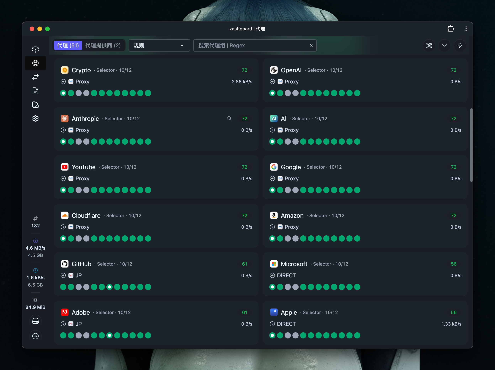

<p align="center">
  
</p>

<h1 align="center">Yggdrasil</h1>

<p align="center">
  Mihomo 配置与订阅工具<br />
  以 Ratatoskr 为核心模板，生成可按需组合的个人配置。
</p>

<p align="center">
  <a href="https://wiki.metacubex.one/"></a>
  <a href="#geo-驱动的超轻量配置"></a>
  <a href="../LICENSE"></a>
</p>

<p align="center">
  <a href="#项目架构">项目架构</a> ·
  <a href="#一站式订阅">一站式订阅</a> ·
  <a href="#ratatoskr--轻量配置本体">Ratatoskr</a> ·
  <a href="#配置选择">配置选择</a> ·
  <a href="#快速开始">快速开始</a> ·
  <a href="#自定义与扩展">自定义与扩展</a> ·
  <a href="en.md">English</a> ·
  <a href="../README.md">封面</a>
</p>

---

## 项目架构

**Yggdrasil 是应用与工具集合，Ratatoskr 是其中的核心配置。** Yggdrasil 提供配置工坊、模板解析、配置生成与可选订阅服务；Ratatoskr 定义 Mihomo 的应用规则、地区目录、节点筛选和策略组。

配置工坊读取 Ratatoskr 模板中的目录与规则，将用户选择的节点和出口组合成 YAML。这样模板既是可直接使用的配置基础，也是应用目录与生成器共同遵循的数据来源。

**Yggdrasil 负责组织、生成与交付；Ratatoskr 是抵达使用者手中的配置本体。**

## 一站式订阅

Yggdrasil 面向一站式的使用体验：使用者通过 config-builder 模块选择自己需要的配置内容，获得加工后生成的配置文件或订阅链接，再交给客户端使用。

<p align="center"><strong>选择所需内容 → 组装个人配置 → 获取文件或订阅 → 导入客户端</strong></p>

打开部署后的 **Ratatoskr 配置工坊**（`https://<项目名>.pages.dev/config-builder/`，[部署方式](../config-builder/docs/DEPLOYMENT.md)），依次完成五步：

1. **订阅来源。** 填写机场名称与 YAML、Base64 或常见节点链接订阅，随后解析节点和机场报告的流量信息。
2. **地区节点。** 只展示订阅中确实拥有的地区，选择需要保留的节点范围。
3. **节点策略。** 四种自动策略按需保留，默认出口为手动选择。
4. **APP 分流。** 默认全部启用并跟随代理，也可指定已保留的地区、Direct 或 Reject。规则和最终出口由模板统一维护。
5. **最终确认。** 预览配置，下载 `名字-ratatoskr.yaml`，或生成持久订阅链接。

**[shared/catalog.json](../config-builder/shared/catalog.json)** 是 APP、地区与规则的静态目录数据。新增 APP 或地区时直接编辑该文件，构建后页面目录和后端模板随之更新；重新部署 Pages 后，同一 Token 可取得新的配置。完整的数据流与每项功能的位置见 **[实现路径](../config-builder/docs/IMPLEMENTATION.md)**。

个人订阅使用独立随机 Token，持续时间可选 **3 小时 / 7 天 / 30 天 / 永久**。配置标题下的 catalog 指纹只标识模板版本，不用作访问凭据。节点来源保留 `[P1]`、`[P2]` 标识。

配置工坊与订阅服务同源部署在 Cloudflare Pages：页面把机场链接提交给同源接口，由服务端拉取与解码，直接连接 KV 保存加密配置与 YAML 快照。生成配置包含所选地区的完整节点，支持文件下载与持久订阅链接。GitHub 负责代码托管与 Actions 构建，Cloudflare Pages 负责静态资源、Functions 接口与 KV，两者免费额度即可运行，无需自建或租用服务器；公开入口为 `https://<项目名>.pages.dev/config-builder/`。仓库提供通用部署模板，使用自己的项目名称与 KV 绑定接入，见 **[部署指南与故障复盘](../config-builder/docs/DEPLOYMENT.md)**。

没有独立的本地模式，也没有手动填写服务地址的入口：服务未就绪时向导会停止并提示重试；GitHub Pages 上的静态副本不提供可用功能。

机场流量来自 `Subscription-Userinfo`，随订阅或手动刷新更新；缺失时明确显示未知。可选检测测量服务器到节点的 TCP 建连耗时，不将其标为 ICMP ping 或完整代理延迟。

## Ratatoskr · 轻量配置本体

Ratatoskr 将庞大的分类数据交给 Geo 数据库，将清晰的分流意图留在配置文件中。应用走向、直连范围、节点组织与出口策略集中编排，既便于直接使用，也方便维护者理解和扩展。

### Geo 驱动的超轻量配置

- **GeoSite 管理域名分类。** 用应用与服务分类表达分流范围，减少在 YAML 中逐条维护大量域名的负担。
- **GeoIP 提供 IP 分类匹配。** 配合域名规则，处理适合按 IP 分类识别的目标。
- **补充规则保留定制空间。** 通过少量 `rule-providers` 承接自定义域名、IP 与端口规则。
- **配置本体保持精简。** 当前主模板约 **22 KB**，主要保留分类引用、匹配顺序与策略编排。

体积仅指 YAML 配置本身。Geo 数据库仍需由客户端或内核加载、更新；轻量体现为更小的配置本体与更低的规则编排维护负担。

### 全栈式精准分流

将目标匹配、规则优先级、策略编排与出口选择连接起来，覆盖完整的分流链路。

| 分流维度 | 配置负责什么 |
| :--- | :--- |
| 应用与服务 | 为 AI、社交、通信、流媒体、游戏等服务设置独立出口 |
| 分类规则 | 以 Geo 分类组织国内外流量、应用类别与通用代理范围 |
| 域名与 IP | 组合 GeoSite、GeoIP 和自定义补充规则进行匹配 |
| 端口与例外 | 为特殊端口、指定目标和个性化例外保留独立规则 |
| 节点与地区 | 按名称组织地区节点，组合手动选择、自动选择和故障转移 |
| 出口与兜底 | 使用一致性哈希、轮询及最终出口，处理不同连接需求 |

规则按顺序匹配。实际分流效果由规则优先级、Geo 数据内容与客户端能力共同决定；地区节点分组按名称筛选，实际落地以机场说明为准。

<details>
<summary><strong>查看内置节点策略</strong></summary>

| 策略 | 行为 |
| :--- | :--- |
| 🚀 手动切换 | 固定使用选中的节点 |
| ♻️ 自动选择 | 根据延迟测试结果选择节点 |
| 🔯 故障转移 | 按顺序使用首个可用节点 |
| 🔮 负载均衡 | `consistent-hashing`，同一目标尽量保持相同出口 |
| ⚖️ 下载均衡 | `round-robin`，轮询分配新连接 |

应用是否使用某个策略，由其可选项、当前选择与规则命中决定。轮询不拆分单条连接，也不保证多节点带宽叠加。

模板启用 `unified-delay: true`，优先通过复用连接的第二次请求计算延迟。相关说明见 [Mihomo 全局配置](https://wiki.metacubex.one/config/general/#统一延迟)。

</details>

## 模块化与可维护性

规则数据、路由意图、出口策略与节点来源分层维护，让每一处变化都能落到明确的位置。

| 层次 | 职责与维护入口 |
| :--- | :--- |
| 分类数据 | GeoSite / GeoIP 提供分类数据，数据更新与 YAML 编排分离 |
| 路由规则 | `rules` 表达匹配顺序；`rule-providers` 接入额外规则集 |
| 策略组 | `proxy-groups` 组织应用出口、地区分组与连接策略 |
| 节点来源 | `proxy-providers` / `proxies` 管理机场订阅与手动节点 |
| 配置交付 | 共享生成器组装选中模块，配置服务加密保存，通过公开网关交付私密链接 |

- **易维护。** 共享 Geo 分类与规则锚点，减少重复配置；订阅、策略与规则分别定位。
- **可扩展。** 新增应用、地区或规则源时，沿用现有分组与引用方式继续生长。
- **可自定义。** 调整目标匹配、规则优先级、节点筛选和出口选择，保留自己的使用习惯。
- **便于组合。** 配置工坊复用模板目录与共享生成器，按选择组装个人配置。

## 配置选择

仓库以 **[Ratatoskr](../resources/template/ratatoskr-template.yaml)** 作为唯一主配置模板：Geo 驱动的轻量分流，内置常用地区分组与其他节点入口。DNS、TUN、流量嗅探等网络接管功能按客户端环境自行配置。

<details>
<summary><strong>查看配置直链与地区覆盖</strong></summary>

取得授权后，可下载文件或将配置地址导入客户端：

- [Release 直链](https://github.com/yakasuka/yggdrasil/releases/latest/download/ratatoskr-template.yaml)（推荐）
- [ratatoskr-template.yaml 源文件](https://raw.githubusercontent.com/yakasuka/yggdrasil/main/resources/template/ratatoskr-template.yaml)

**常用地区**：香港、台湾、日本、韩国、新加坡、美国，另设“其他”入口；具体范围由模板的筛选规则决定。

</details>

## 快速开始

推荐从 [配置工坊](https://yakasuka.github.io/yggdrasil/config-builder/) 开始；也可以手动使用模板：

1. **确认授权。** 取得相应原作者或权利人的书面许可，条款见 [LICENSE](../LICENSE)。
2. **选择配置。** 使用 `resources/template/ratatoskr-template.yaml`，或从 Release 获取固定直链。
3. **准备节点与数据。** 在本地维护自己的 `proxy-providers` 或 `proxies`，并准备包含所用分类的 GeoSite / GeoIP 数据。
4. **导入并选择出口。** 在 Mihomo 客户端中加载配置，按应用或地区选择策略，重新执行延迟测试。

配置默认 HTTP / SOCKS5 混合端口为 `7890`，配置工坊可自定义端口。个人订阅地址、节点凭据与访问令牌应在本地或私有流程中维护。

## 自定义与扩展

可以从一个域名例外开始，也可以继续生长出新的应用、地区与出口策略。

| 需要调整什么 | 修改位置 |
| :--- | :--- |
| 替换机场或加入手动节点 | `proxy-providers` / `proxies` |
| 为某个应用指定出口 | 对应应用的 `proxy-groups` 与 `rules` |
| 加入自己的域名、IP 或端口例外 | 在现有 `rules` 中插入规则，或接入补充规则集 |
| 增加地区分类 | 节点筛选锚点、地区策略组及其引用 |
| 改变连接分配方式 | 策略组类型、候选节点和负载均衡参数 |
| 更换图标 | 策略组 `icon` 与相应图标说明 |

例如，为一个域名增加代理规则，可将下面的规则项插入现有 `rules` 列表，放在会覆盖它的通用规则及最终兜底之前：

```yaml
- DOMAIN-SUFFIX,example.com,🎚️ 节点选择
```

扩展策略组或重命名规则源时，同步更新引用；修改后重新加载并检查实际命中结果。

<details>
<summary><strong>维护者：订阅接口与部署约定</strong></summary>

订阅接口是运行在自建 Node 服务上的公开 API，Cloudflare Pages 与 GitHub Pages 只发布静态前端，不读取或返回任何节点内容：

| 接口 | 实现与职责 |
| :--- | :--- |
| `/api/inspect` | 后端拉取用户输入的机场订阅，只返回脱敏节点与流量清单 |
| `/api/preview` | 按网页选择实时生成完整 YAML，供预览 / 下载 |
| `/api/subscriptions` | 加密保存选择，返回自带随机密钥的订阅链接 |
| `/subscription/<id>/<key>.yaml` | 客户端拉取时重新解析机场、按最新模板与所选规则模块实时生成配置 |
| `/api/endpoints` | 由后端直接吐出上述链接模板，不含任何凭据 |

环境变量写在 `config-builder/server/.env`：`PUBLIC_BASE_URL` 决定生成链接的对外域名，`ALLOWED_ORIGINS` 限定可调用的前端，`TEMPLATE_URL=bundled` 表示使用仓库示例模板 `resources/template/ratatoskr-template.yaml` 的同源快照。没有共享 TOKEN，也不读取私有仓库——访问能力完全由订阅链接自身的随机 ID 与密钥承载。详见 [部署指南](../config-builder/docs/DEPLOYMENT.md)。

后端地址统一写在构建变量 `SERVICE_BASE_URL` 或仓库根 `service.json` 中。[call-service.yml](../.github/workflows/call-service.yml) 从 Actions 做只读冒烟测试，只输出状态码与链接模板。旧的 `/merge`、`/sub` 私有仓库链路与静态跳转页已完全移除。

配置工坊使用同一套自建 [配置服务](../config-builder/worker/README.md)，按网页选项（含「规则模块」按钮块）生成配置；订阅链接由后端直接返回，不经过 CF 或 GitHub Pages。

</details>

## 图标与视觉

应用和地区图标用于标识策略组，在配置工坊和 Mihomo 面板中帮助使用者快速识别出口。图标位于 `assets/icons/` 与 `assets/icons/macosicons/`。

<p align="center">
  
  
  
  
  
  
</p>

[品牌标识](../assets/README.md) · [图标预览](../assets/icons/macosicons/preview.png) · [图标作者与来源](../assets/icons/macosicons/README.md) · [映射清单](../assets/icons/macosicons/manifest.json)

图标作品、品牌标识及面板素材的权利归各自权利人所有。

<details>
<summary><strong>查看 Mihomo 控制面板参考</strong></summary>



Mihomo 运行时的 Zashboard 控制面板参考；分组名称、节点状态与数值以所选配置和实际运行结果为准。

</details>

## 常见问题

**配置为什么很小，规则仍能覆盖很多服务？**

Ratatoskr 引用 Geo 数据分类，具体域名和 IP 数据由数据库承载。配置保留分类引用、匹配顺序和出口编排；数据库仍需单独加载。

**拿到一个 YAML 就能在所有客户端使用吗？**

配置面向 Mihomo，客户端需支持相应语法，并具备所引用的 Geo 分类。DNS、TUN 等网络接管功能按所选模板和设备环境配置。

**后续维护需要反复重写全部配置吗？**

Geo 数据分类、补充规则源、节点订阅和出口策略分别维护。按客户端机制更新数据，在需要时调整对应规则或策略组；分类名称和引用仍需保持有效。

## 许可与反馈

**All Rights Reserved · Prior Written Permission Required**

项目原创内容的使用、运行、修改、再分发、公开部署及商业使用，须事先取得相应原作者或权利人的书面许可；个人与非商业用途同样适用。完整范围、例外与免责条款见 [LICENSE](../LICENSE)。第三方素材继续遵循各自许可，适用法律、GitHub 平台条款和既有有效授权不受排除。

通过 [Issues](https://github.com/yakasuka/yggdrasil/issues) 反馈问题或申请授权。问题反馈请附客户端与内核版本、所用配置和预期分流结果，并移除订阅令牌与节点凭据。

### 贡献者

项目由 [yakasuka](https://github.com/yakasuka) 主导维护，以下协作者以不同方式参与了配置整理、脚本编写、文档与自动化工作：

| 贡献者 | 角色 |
| :--- | :--- |
| [yakasuka](https://github.com/yakasuka) | 项目主导与维护 |
| [tobyxdd](https://github.com/tobyxdd) | Hysteria 协议支持 |
| [Zephyruso](https://github.com/Zephyruso) | zashboard 面板参考 |
| [Dreamacro](https://github.com/Dreamacro) | Clash 配置生态奠基 |
| [Aethersailor](https://github.com/Aethersailor) | 自定义分流规则来源 |
| [Fndroid](https://github.com/Fndroid) | 客户端生态参考 |
| [Codex](https://github.com/codex) | 配置整理与脚本编写 |
| [Claude](https://github.com/claude) | 代码与文档协作 |
| [Eaibee Kitajima](https://github.com/EaibeeKitajima) | 早期规则与配置贡献 |
| [github-actions[bot]](https://github.com/apps/github-actions) | 规则与目录自动同步 |
| [dependabot[bot]](https://github.com/apps/dependabot) | 依赖更新 |

GitHub 侧栏的 Contributors 列表由提交作者与 `Co-authored-by` 共同作者聚合；个人账号使用各自的署名邮箱，因此头像与主页可正确显示。组织类上游（如 Mihomo / AdGuard / ACL4SSR）见下方致谢。

### 致谢与参考

本项目建立在以下开源成果之上，谨此致谢。以下均为各自上游项目的作品，权利归原作者所有；本项目仅作引用与整合：

| 上游项目 | 作者 / 组织 | 在本项目中的作用 |
| :--- | :--- | :--- |
| [Mihomo](https://github.com/MetaCubeX/mihomo) | [MetaCubeX](https://github.com/MetaCubeX) | 配置所面向的核心内核与文档 |
| [Hysteria](https://github.com/apernet/hysteria) | [tobyxdd](https://github.com/tobyxdd) | Hysteria2 协议支持 |
| [AdGuard Filters](https://github.com/AdguardTeam/AdguardFilters) | [AdGuardTeam](https://github.com/AdguardTeam) | 桌面级广告拦截规则来源 |
| [zashboard](https://github.com/Zephyruso/zashboard) | [Zephyruso](https://github.com/Zephyruso) | 面板界面参考 |
| [Custom OpenClash Rules](https://github.com/Aethersailor/Custom_OpenClash_Rules) | [Aethersailor](https://github.com/Aethersailor) | 自定义分流规则来源 |
| [ACL4SSR](https://github.com/ACL4SSR/ACL4SSR) | [ACL4SSR](https://github.com/ACL4SSR) | README 版本对照、规则分类与组织方式参考 |
| [Clash 配置生态](https://github.com/Dreamacro) | [Dreamacro](https://github.com/Dreamacro) | Clash 配置生态奠基（原仓库已归档） |
| [Clash for Android](https://github.com/Fndroid) | [Fndroid](https://github.com/Fndroid) | 客户端生态参考（原仓库已归档） |
| [macOSicons](https://macosicons.com/) | 见[图标来源表](../assets/icons/macosicons/README.md) | 策略组图标素材，逐项署名见来源表 |
| [uhovohu/clash](https://github.com/uhovohu/clash) | uhovohu | 日常模板历史图标地址的引用来源 |

---

<p align="center"><sub>Yggdrasil × Ratatoskr · 配置工具与核心模板协同工作。</sub></p>


