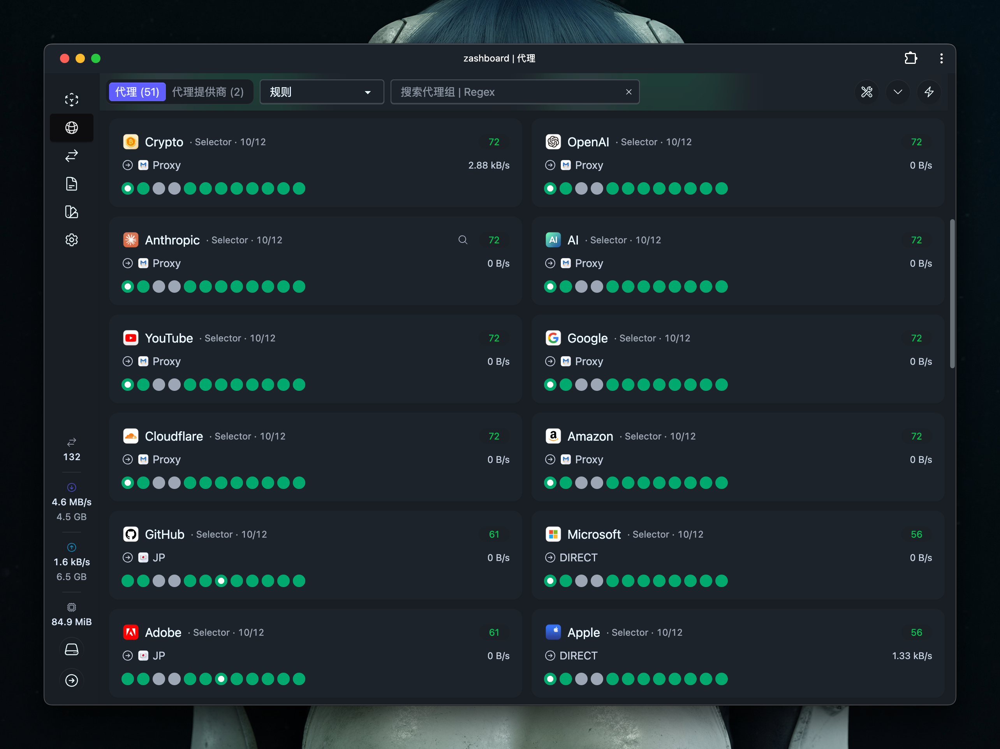

<p align="center">
  
</p>

<h1 align="center">Yggdrasil</h1>

<p align="center">
  Mihomo 配置与订阅工具<br />
  以 Ratatoskr 为核心模板，生成可按需组合的个人配置。
</p>

<p align="center">
  <a href="https://wiki.metacubex.one/"></a>
  <a href="#geo-驱动的超轻量配置"></a>
  <a href="../LICENSE"></a>
</p>

<p align="center">
  <a href="#项目架构">项目架构</a> ·
  <a href="#一站式订阅">一站式订阅</a> ·
  <a href="#ratatoskr--轻量配置本体">Ratatoskr</a> ·
  <a href="#配置选择">配置选择</a> ·
  <a href="#快速开始">快速开始</a> ·
  <a href="#自定义与扩展">自定义与扩展</a> ·
  <a href="en.md">English</a> ·
  <a href="../README.md">封面</a>
</p>

---

## 项目架构

**Yggdrasil 是应用与工具集合，Ratatoskr 是其中的核心配置。** Yggdrasil 提供配置工坊、模板解析、配置生成与可选订阅服务；Ratatoskr 定义 Mihomo 的应用规则、地区目录、节点筛选和策略组。

配置工坊读取 Ratatoskr 模板中的目录与规则，将用户选择的节点和出口组合成 YAML。这样模板既是可直接使用的配置基础，也是应用目录与生成器共同遵循的数据来源。

**Yggdrasil 负责组织、生成与交付；Ratatoskr 是抵达使用者手中的配置本体。**

## 一站式订阅

Yggdrasil 面向一站式的使用体验：使用者通过 config-builder 模块选择自己需要的配置内容，获得加工后生成的配置文件或订阅链接，再交给客户端使用。

<p align="center"><strong>选择所需内容 → 组装个人配置 → 获取文件或订阅 → 导入客户端</strong></p>

打开 **[Ratatoskr 配置工坊](https://yakasuka.github.io/yggdrasil/config-builder/)**，依次完成五步：

1. **订阅来源。** 填写机场名称与 YAML、Base64 或常见节点链接订阅，随后解析节点和机场报告的流量信息。
2. **地区节点。** 只展示订阅中确实拥有的地区，选择需要保留的节点范围。
3. **节点策略。** 四种自动策略按需保留，默认出口为手动选择。
4. **APP 分流。** 默认全部启用并跟随代理，也可指定已保留的地区、Direct 或 Reject。规则和最终出口由模板统一维护。
5. **最终确认。** 预览配置，下载 `名字-ratatoskr.yaml`，或在服务上线后生成持久订阅链接。

**[ratatoskr-template.yaml](../resources/template/ratatoskr-template.yaml)** 是 APP、地区与规则的唯一目录来源。模板新增 APP 或地区后，构建会同步页面目录和后端模板；重新部署 Pages 后，同一 Token 可取得新的配置。完整的数据流与每项功能的位置见 **[实现路径](../config-builder/docs/IMPLEMENTATION.md)**。

个人订阅使用独立随机 Token，持续时间可选 **3 小时 / 7 天 / 30 天 / 永久**。配置标题下的 catalog 指纹只标识模板版本，不用作访问凭据。节点来源保留 `[P1]`、`[P2]` 标识。

GitHub Pages 提供静态前端入口；完整在线服务使用 Cloudflare Pages 同时承载前端与接口，直接连接 KV 保存加密配置与 YAML 快照。网页优先直接读取与解码订阅；遇到跨域限制时由同源接口代取。生成配置包含所选地区的完整节点，支持文件下载与持久订阅链接。仓库提供通用部署模板，使用自己的项目名称与 KV 绑定接入，见 **[部署指南与故障复盘](../config-builder/docs/DEPLOYMENT.md)**。

尚未部署服务时，GitHub Pages 入口明确显示本地模式，可直接解析允许跨域的订阅或导入节点文件，完成预览和下载。服务上线后，在页面“连接设置”中接入，或由维护者填写默认公开地址；跨域代取和持久订阅需要该服务实际可用。

机场流量来自 `Subscription-Userinfo`，随订阅或手动刷新更新；缺失时明确显示未知。可选检测测量服务器到节点的 TCP 建连耗时，不将其标为 ICMP ping 或完整代理延迟。

## Ratatoskr · 轻量配置本体

Ratatoskr 将庞大的分类数据交给 Geo 数据库，将清晰的分流意图留在配置文件中。应用走向、直连范围、节点组织与出口策略集中编排，既便于直接使用，也方便维护者理解和扩展。

### Geo 驱动的超轻量配置

- **GeoSite 管理域名分类。** 用应用与服务分类表达分流范围，减少在 YAML 中逐条维护大量域名的负担。
- **GeoIP 提供 IP 分类匹配。** 配合域名规则，处理适合按 IP 分类识别的目标。
- **补充规则保留定制空间。** 通过少量 `rule-providers` 承接自定义域名、IP 与端口规则。
- **配置本体保持精简。** 当前主模板约 **22 KB**，主要保留分类引用、匹配顺序与策略编排。

体积仅指 YAML 配置本身。Geo 数据库仍需由客户端或内核加载、更新；轻量体现为更小的配置本体与更低的规则编排维护负担。

### 全栈式精准分流

将目标匹配、规则优先级、策略编排与出口选择连接起来，覆盖完整的分流链路。

| 分流维度 | 配置负责什么 |
| :--- | :--- |
| 应用与服务 | 为 AI、社交、通信、流媒体、游戏等服务设置独立出口 |
| 分类规则 | 以 Geo 分类组织国内外流量、应用类别与通用代理范围 |
| 域名与 IP | 组合 GeoSite、GeoIP 和自定义补充规则进行匹配 |
| 端口与例外 | 为特殊端口、指定目标和个性化例外保留独立规则 |
| 节点与地区 | 按名称组织地区节点，组合手动选择、自动选择和故障转移 |
| 出口与兜底 | 使用一致性哈希、轮询及最终出口，处理不同连接需求 |

规则按顺序匹配。实际分流效果由规则优先级、Geo 数据内容与客户端能力共同决定；地区节点分组按名称筛选，实际落地以机场说明为准。

<details>
<summary><strong>查看内置节点策略</strong></summary>

| 策略 | 行为 |
| :--- | :--- |
| 🚀 手动切换 | 固定使用选中的节点 |
| ♻️ 自动选择 | 根据延迟测试结果选择节点 |
| 🔯 故障转移 | 按顺序使用首个可用节点 |
| 🔮 负载均衡 | `consistent-hashing`，同一目标尽量保持相同出口 |
| ⚖️ 下载均衡 | `round-robin`，轮询分配新连接 |

应用是否使用某个策略，由其可选项、当前选择与规则命中决定。轮询不拆分单条连接，也不保证多节点带宽叠加。

模板启用 `unified-delay: true`，优先通过复用连接的第二次请求计算延迟。相关说明见 [Mihomo 全局配置](https://wiki.metacubex.one/config/general/#统一延迟)。

</details>

## 模块化与可维护性

规则数据、路由意图、出口策略与节点来源分层维护，让每一处变化都能落到明确的位置。

| 层次 | 职责与维护入口 |
| :--- | :--- |
| 分类数据 | GeoSite / GeoIP 提供分类数据，数据更新与 YAML 编排分离 |
| 路由规则 | `rules` 表达匹配顺序；`rule-providers` 接入额外规则集 |
| 策略组 | `proxy-groups` 组织应用出口、地区分组与连接策略 |
| 节点来源 | `proxy-providers` / `proxies` 管理机场订阅与手动节点 |
| 配置交付 | 共享生成器组装选中模块，配置服务加密保存，通过公开网关交付私密链接 |

- **易维护。** 共享 Geo 分类与规则锚点，减少重复配置；订阅、策略与规则分别定位。
- **可扩展。** 新增应用、地区或规则源时，沿用现有分组与引用方式继续生长。
- **可自定义。** 调整目标匹配、规则优先级、节点筛选和出口选择，保留自己的使用习惯。
- **便于组合。** 配置工坊复用模板目录与共享生成器，按选择组装个人配置。

## 配置选择

以 Ratatoskr 为主配置，根据地区分类和网络接管需求选择对应文件。

| 文件 | 定位 | 主要内容 |
| :--- | :--- | :--- |
| **[Ratatoskr](../resources/ratatoskr.yaml)** | 日常主配置 | Geo 驱动的轻量分流，6 个常用地区与其他节点入口 |
| **[Ratatosk · Eb](../resources/template/ratatosk-Eb.yaml)** | 地区扩展 | 24 个国家 / 地区分组，使用 macOSicons 图标 |
| **[yggdrasil.yaml](../resources/yggdrasil.yaml)** | 完整网络栈参考 | DNS、TUN、流量嗅探与详细外部规则集 |

`Ratatosk-Eb.yaml` 沿用仓库现有文件名。三份配置独立维护，规则与策略组并不完全相同；当前主模板的轻量 Geo 架构不代表所有参考配置使用同一种规则组织方式。

<details>
<summary><strong>查看配置直链与地区覆盖</strong></summary>

取得授权后，可下载文件或将配置地址导入客户端：

- [ratatoskr.yaml](https://raw.githubusercontent.com/yakasuka/yggdrasil/main/resources/ratatoskr.yaml)
- [Ratatosk-Eb.yaml](https://raw.githubusercontent.com/yakasuka/yggdrasil/main/resources/template/ratatosk-Eb.yaml)
- [yggdrasil.yaml](https://raw.githubusercontent.com/yakasuka/yggdrasil/main/resources/yggdrasil.yaml)

**常用地区**：香港、台湾、日本、韩国、新加坡、美国。

**Eb 扩展地区**：香港、台湾、澳门、日本、韩国、新加坡、泰国、马来西亚、越南、菲律宾、印度尼西亚、印度、澳大利亚、美国、加拿大、英国、德国、法国、荷兰、瑞士、俄罗斯、土耳其、巴西、阿根廷。

另设“其他”入口，具体范围由各模板的筛选规则决定。

</details>

## 快速开始

推荐从 [配置工坊](https://yakasuka.github.io/yggdrasil/config-builder/) 开始；也可以手动使用模板：

1. **确认授权。** 取得相应原作者或权利人的书面许可，条款见 [LICENSE](../LICENSE)。
2. **选择配置。** 日常使用从 `ratatoskr.yaml` 开始；需要更细地区分组时选择 Eb 版。
3. **准备节点与数据。** 在本地维护自己的 `proxy-providers` 或 `proxies`，并准备包含所用分类的 GeoSite / GeoIP 数据。
4. **导入并选择出口。** 在 Mihomo 客户端中加载配置，按应用或地区选择策略，重新执行延迟测试。

部署了合并接口的维护者，可将生成的 `/merge?token=…` 地址作为订阅入口。具体地址、令牌和可用功能以实际部署为准。

| 配置 | HTTP | SOCKS5 |
| :--- | :--- | :--- |
| Ratatoskr / Eb 手动模板 | `7890` | `7891` |
| 配置工坊生成文件 | `7890` | `7890` |
| 完整网络栈参考 | `7890` | `7890` |

配置工坊与完整网络栈参考使用混合端口；工坊可自定义端口。个人订阅地址、节点凭据与访问令牌应在本地或私有流程中维护。

## 自定义与扩展

可以从一个域名例外开始，也可以继续生长出新的应用、地区与出口策略。

| 需要调整什么 | 修改位置 |
| :--- | :--- |
| 替换机场或加入手动节点 | `proxy-providers` / `proxies` |
| 为某个应用指定出口 | 对应应用的 `proxy-groups` 与 `rules` |
| 加入自己的域名、IP 或端口例外 | 在现有 `rules` 中插入规则，或接入补充规则集 |
| 增加地区分类 | 节点筛选锚点、地区策略组及其引用 |
| 改变连接分配方式 | 策略组类型、候选节点和负载均衡参数 |
| 更换图标 | 策略组 `icon` 与相应图标说明 |

例如，为一个域名增加代理规则，可将下面的规则项插入现有 `rules` 列表，放在会覆盖它的通用规则及最终兜底之前：

```yaml
- DOMAIN-SUFFIX,example.com,🎚️ 节点选择
```

扩展策略组或重命名规则源时，同步更新引用；修改后重新加载并检查实际命中结果。

<details>
<summary><strong>维护者：订阅接口与部署约定</strong></summary>

仓库提供适用于 Cloudflare Pages Functions 的接口：

| 接口 | 实现与职责 |
| :--- | :--- |
| `/merge?token=…` | [merge.js](../functions/merge.js)：读取公开模板，将私有 `providers.yaml` 注入自动订阅标记区 |
| `/sub?token=…` | [sub.js](../functions/sub.js)：读取私有 `providers.yaml`，原样返回订阅提供方 YAML |

环境变量：`TOKEN` 用于接口鉴权，`GH_TOKEN` 用于读取私有仓库，`PUBLIC_CONFIG_URL` 指定合并接口使用的模板地址。

以上为保留的旧接口，仍引用 `yakasuka/yggdrasil-private`；新的 Pages 构建不发布该目录，也不需要 GitHub 读取 Token。若另行启用旧接口，须同步配置仓库位置、凭据和模板地址，并保留成对的 `AUTO-PROVIDERS-START` / `AUTO-PROVIDERS-END` 标记。

现有 `/merge` 获取公开配置并将私有 `providers.yaml` 注入自动订阅标记区；`/sub` 直接提供私有 `providers.yaml`。新的配置工坊使用独立的 [配置服务与网关](../config-builder/worker/README.md)，按网页选项生成配置。

</details>

## 图标与视觉

应用和地区图标用于标识策略组，在配置工坊和 Mihomo 面板中帮助使用者快速识别出口。日常模板的图标位于 `assets/icons/`；Eb 版使用 macOSicons 图标集。

<p align="center">
  
  
  
  
  
  
</p>

[品牌标识](../assets/README.md) · [Eb 图标预览](../assets/icons/macosicons/preview.png) · [图标作者与来源](../assets/icons/macosicons/README.md) · [映射清单](../assets/icons/macosicons/manifest.json)

日常模板使用 `assets/icons/` 中的图标；Eb 版使用 42 张 macOSicons PNG。图标作品、品牌标识及面板素材的权利归各自权利人所有。

<details>
<summary><strong>查看 Mihomo 控制面板参考</strong></summary>



Mihomo 运行时的 Zashboard 控制面板参考；分组名称、节点状态与数值以所选配置和实际运行结果为准。

</details>

## 常见问题

**配置为什么很小，规则仍能覆盖很多服务？**

Ratatoskr 引用 Geo 数据分类，具体域名和 IP 数据由数据库承载。配置保留分类引用、匹配顺序和出口编排；数据库仍需单独加载。

**拿到一个 YAML 就能在所有客户端使用吗？**

配置面向 Mihomo，客户端需支持相应语法，并具备所引用的 Geo 分类。DNS、TUN 等网络接管功能按所选模板和设备环境配置。

**后续维护需要反复重写全部配置吗？**

Geo 数据分类、补充规则源、节点订阅和出口策略分别维护。按客户端机制更新数据，在需要时调整对应规则或策略组；分类名称和引用仍需保持有效。

## 许可与反馈

**All Rights Reserved · Prior Written Permission Required**

项目原创内容的使用、运行、修改、再分发、公开部署及商业使用，须事先取得相应原作者或权利人的书面许可；个人与非商业用途同样适用。完整范围、例外与免责条款见 [LICENSE](../LICENSE)。第三方素材继续遵循各自许可，适用法律、GitHub 平台条款和既有有效授权不受排除。

通过 [Issues](https://github.com/yakasuka/yggdrasil/issues) 反馈问题或申请授权。问题反馈请附客户端与内核版本、所用配置和预期分流结果，并移除订阅令牌与节点凭据。

### 致谢与参考

- [Mihomo](https://github.com/MetaCubeX/mihomo)：配置所面向的内核与文档。
- [ACL4SSR](https://github.com/ACL4SSR/ACL4SSR)：README 的版本对照、规则分类与使用入口组织参考。
- [Custom OpenClash Rules](https://github.com/Aethersailor/Custom_OpenClash_Rules)：自定义补充规则来源。
- [macOSicons](https://macosicons.com/)：Eb 版图标作品，逐项署名见图标来源表。
- [uhovohu/clash](https://github.com/uhovohu/clash)：日常模板历史图标地址的引用来源。

---

<p align="center"><sub>Yggdrasil × Ratatoskr · 配置工具与核心模板协同工作。</sub></p>


